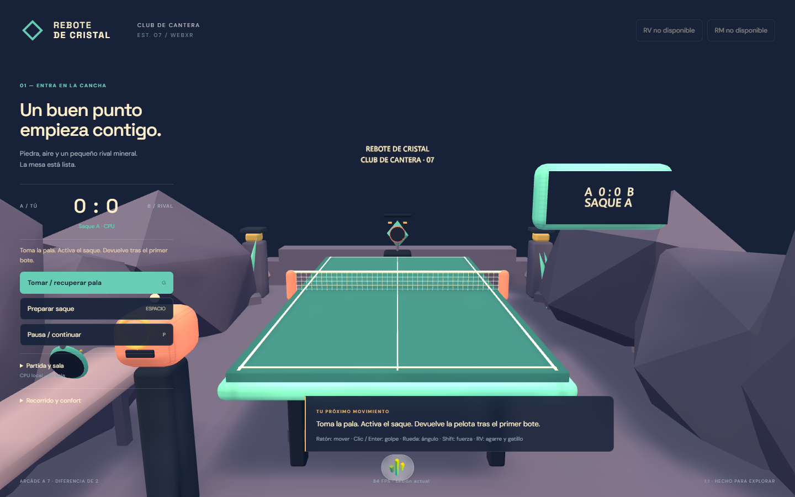
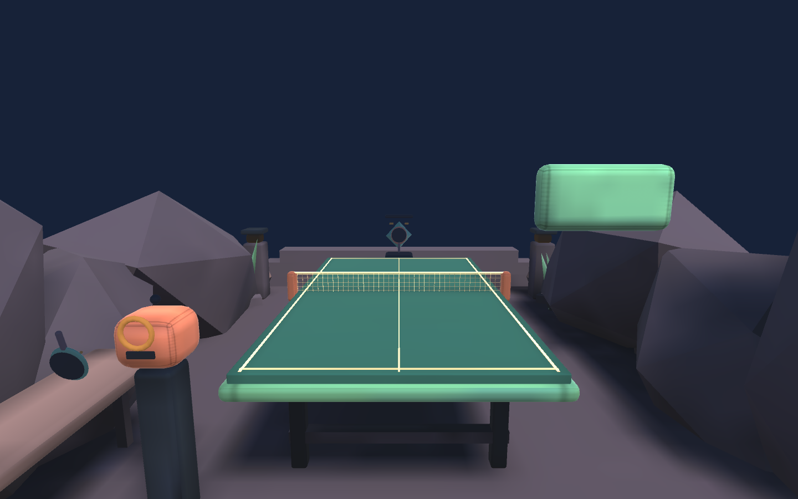
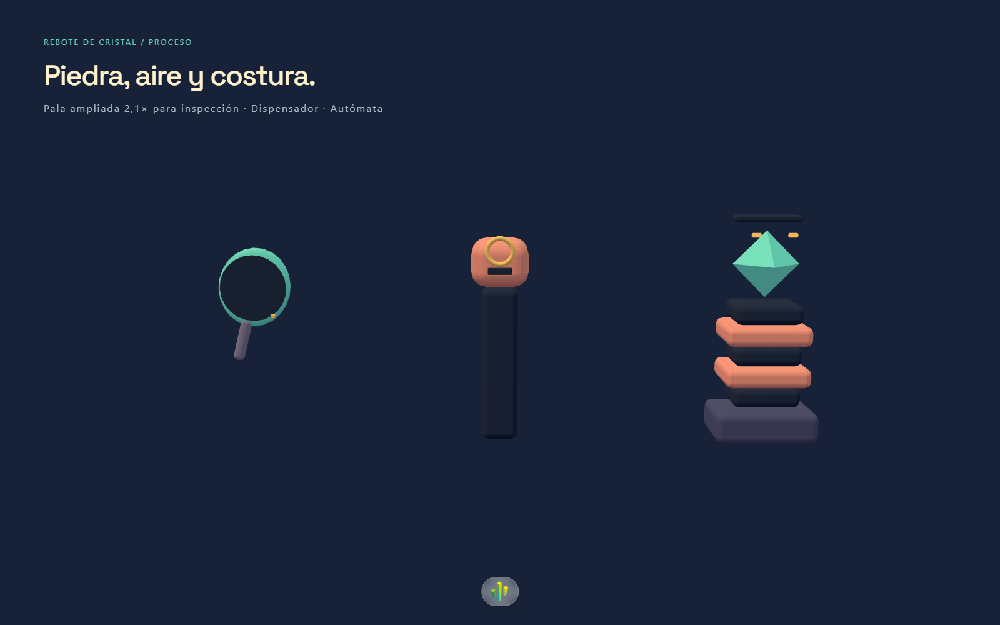
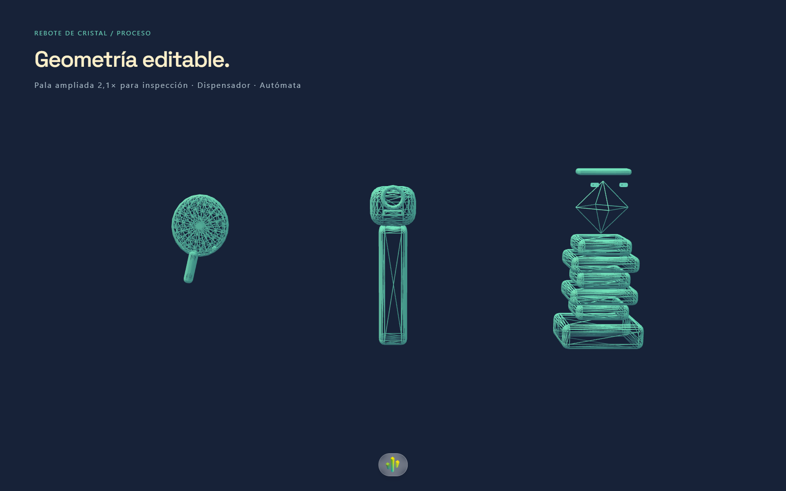

# Portafolio preparado para el equipo

**Estado:** texto y selección de evidencias preparados. Sin publicación: el usuario pidió conservarlo preparado en archivos. Cada integrante debe revisar sus aportes reales antes de publicar.

## Portada

**Rebote de Cristal — Club de Cantera**

Una antigua estación de extracción convertida en club de tenis de mesa. Roca facetada, protecciones neumáticas y un autómata de fuelle conviven alrededor de una mesa a escala humana. Una experiencia WebXR en Needle Engine, con CPU y salas de dos personas.

Captura de escritorio; no es un POV de visor.

Usar una captura real del build final, no una imagen conceptual: `evidencias/08-build-final.png`. Enlace estable: https://rebote-de-cristal-160ydy19qg7w.needle.run/; fuentes: https://github.com/ItsSilva/rebote-de-cristal.

## El reto

El parcial pide explorar un entorno 1:1 e interactuar significativamente con al menos tres elementos. Elegimos tomar una pala, preparar el saque, devolver la pelota y accionar el panel del club. El desafío principal fue conservar una pelota de 40 mm legible y evitar que atravesara una pala delgada entre fotogramas.

Referencias proporcionadas por el equipo: un objeto inflable azul para estudiar presión, costura y reflejo amplio; un diorama de Needle para estudiar facetas, composición y economía de formas. No se reprodujo el emblema ni el personaje de la imagen inflable. Inspiración cromática: [Moonlighter, Digital Sun](https://digitalsungames.com/games/moonlighter/) y [Core Keeper, Pugstorm](https://store.steampowered.com/app/1621690/Core_Keeper/). Confirmar los autores y permisos de las dos imágenes antes de mostrarlas públicamente.

## De los volúmenes al juego

Mesa de 2,74 × 1,525 m, superficie a 0,76 m; red de 0,1525 m; pelota de 0,04 m de diámetro. El origen compartido está bajo el centro de la mesa. Los puestos A/B están en extremos opuestos. Entrada, banco y puesto permiten reconocer la cancha antes de jugar.

Mostrar la escena Unity `ReboteDeCristal.unity`, la captura `04-unity-escala.png` y una comparación real de altura de la mesa en visor que todavía debe grabar el equipo.

## Construcción de los assets

Las fuentes editables son `web/src/world.ts` y `Unity/Assets/Source/cancha.json`. Las mallas y materiales importados son persistentes y el proyecto abre sin Blender. La pala combina un mango explícito, cabeza acolchada, caras de golpe, costura y válvula. La roca conserva planos grandes. El autómata usa pliegues rígidos y una expansión visual pequeña; no se simula tela durante el juego.

La pala aparece ampliada 2,1 veces únicamente en estas láminas de inspección. El juego conserva su escala en metros.

Proceso de textura: la superficie detallada del tejido se muestrea fuera del runtime y se transfiere a normal y oclusión de 1024 px. El entorno se hornea además en Unity con Progressive CPU y UV2. Mostrar las vistas `09-assets-materiales.png` y `10-assets-alambre.png`, el mapa `fabric-normal.png`, su AO, `uv2-atlas-unity.png`, `atlas-unity.png` y el asset dentro del build. Explicar la diferencia entre estos mapas y una medición de FPS.

## Interacción y red

Secuencia recomendada: tomar pala → accionar saque → dos botes válidos → devolución → motivo del punto → revancha. Usar las capturas `05-punto-y-devolucion.png`, `06-pvp-anfitrion.png` y `07-pvp-invitado.png`, verificando que correspondan a la versión de entrega.

El primer ingreso confirmado por la sala reserva la autoridad; el invitado controla su pala de inmediato y el host simula la pelota. El estado de ingreso es persistente durante la sala, mientras las poses y estados frecuentes viajan sin persistir cada movimiento. Se validan sesión, plaza, secuencia y una ventana limitada para el contacto remoto.

Cambios documentados a partir de pruebas reales de desarrollo:

- Se amplió el campo de visión de escritorio para leer la cancha y su entorno.
- Se agrupó geometría estática para reducir llamadas de dibujo.
- Se corrigió el saque que golpeaba la red por exceso de velocidad.
- Se corrigió la elección de anfitrión: la lista de Needle pone primero al propio cliente, por lo que ese índice no representa el orden de ingreso.
- Se añadió ping, compensación de reloj y validación histórica de contacto para que el invitado pudiera devolver y sacar con retardo. Se verificaron diez puntos por HTTPS con ambos marcadores y servicios de acuerdo.
- Se cambió el bake de Unity a codificación normal, exigida por el exportador de Needle.

## Rendimiento y resultado

No afirmar todavía «72 FPS en Quest». Completar con el modelo de Quest, navegador, frecuencia, herramienta, fecha, revisión, serie de cuadros y resultado de los cuatro recorridos indicados en `PRUEBAS_VISOR.md`. Las cifras de escritorio y las simulaciones no sustituyen esa prueba.

Insertar el POV real de 1–2 minutos y los enlaces verificados de GitHub y Needle Cloud. El guion de 90 segundos está en `PRUEBAS_VISOR.md`.

## Equipo y aportes por confirmar

| Integrante | Rol real | Trabajo concreto realizado | Evidencia de autoría o prueba |
|---|---|---|---|
| Juan Silva (juansilva112) | Por confirmar | Pendiente de declaración del integrante | Commit, captura de proceso, asset o registro |
| Majo Rodríguez Martínez (abejitallorona) | Por confirmar | Pendiente de declaración de la integrante | Pendiente |
| Isa Cabrera Sogamoso (isabellcabrera3) | Por confirmar | Pendiente de declaración de la integrante | Pendiente |

Declarar la asistencia de Codex en código, autoría procedural, pruebas y documentación. Distinguir esa asistencia de las decisiones y el trabajo humano que realmente realizó cada persona. No asignar tareas a alguien solo porque su nombre aparece en la cuenta de publicación.

